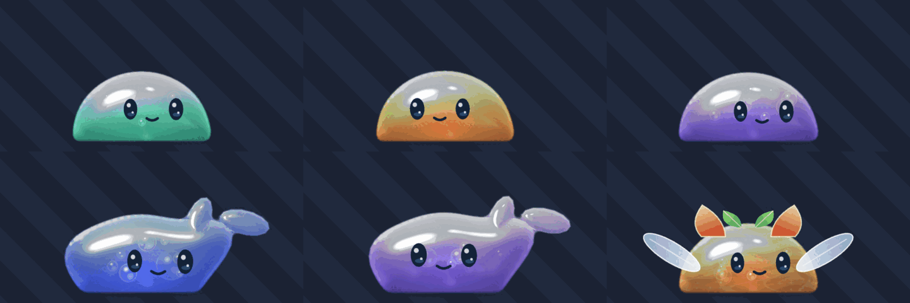
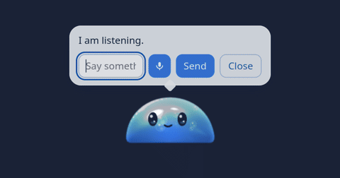

# Slimy

A desktop slime with a real gel body, a personality that grows over the days, and a brain you plug into the model of your choice.

[](https://github.com/Okymi-X/slimy/actions/workflows/ci.yml)
[](LICENSE)


Website: <https://slimy.okymi.org>

Slimy is a companion that lives on your screen. It has a soft body you can push, stretch and throw, a face that follows your pointer, and a memory of the days you spent together. It only has the powers you grant it, one at a time, for a limited time.

## Gallery



Forms and colours the body can take. This is a sheet drawn by the app's own renderer, not a screenshot of a desktop.



Chat. Type or use the microphone, and the answer appears above its head.


Birth. On first launch it hatches, then greets you. The text is a sample from a test soul.

## Features

- Soft body physics: a ring of points with constant volume that rests on surfaces (floor, walls, ceiling), reacts to touch, grab, stretch and throw. Simulation lives in `slimy-body` and runs in the page through WebAssembly.
- Gel shader: WebGL2 rendering of a translucent dome with speculars, fresnel, a core and bubbles.
- Ten expressions driven by a state machine, with a face that follows the pointer and wobbles with the body.
- Relationship (affection, trust, grudge) and reversible sulking. It sulks after two ignored questions in 30 minutes and recovers on the first caress or after 45 minutes.
- Initiative engine: at most 4 questions per hour, never while sulking, answers kept as facts, "later" carries no penalty.
- Birth: an egg cracks, the slime hatches and asks for your name and its own.
- Genome with nightly evolution: a continuous genome (25 genes) is shifted by the day's interactions and digested at night, with each gene moving by at most 0.03 per night and colours kept in OKLCH harmony rules. Property tests cover long runs of nights.
- Memory and reminders: a visible memory panel with forgetting, and reminders announced when the slime is free.
- Brain: 9 providers (Groq, OpenAI, Anthropic, DeepSeek, OpenRouter, xAI, Amazon Bedrock, Ollama, and a custom OpenAI-compatible address) plus a backup provider used once on an outage, rate limit or 5xx. If the brain fails, the slime stays animated.
- MCP tools: servers you declare in `mcp.json`, called only behind the tool power and a Yes/No confirmation in the bubble.
- User skills: Markdown files you write in a `skills/` folder of the data directory (up to 20, 2000 characters each).
- Local voice: speech to text with Whisper and text to speech with Kokoro, both run through sherpa-onnx on your machine. Models are downloaded on demand.
- Behaviour learning: a small contextual bandit (Thompson sampling) in `slimy-learn` that tunes a few bounded choices such as how often the slime speaks and how fast it talks (4 decisions in code). It never changes text or powers, and you can reset it.
- Soul export and import: save and restore the slime as a `.slime` file.
- Multi-screen: it follows the pointer between screens or stays on a chosen one, and adapts its size to the screen.

Each provider other than Groq and the custom address gives the slime its own form (for example a crab for Anthropic, a whale for DeepSeek, a llama for Ollama).

## Privacy model

- Refused by default. Every power starts off: active application, clipboard, screen, files, tools, pointer and microphone.
- Time limited. Grants last at most one hour, and screen, clipboard, pointer and microphone require a duration. Revoking takes effect at once.
- Journaled. Every access, allowed or refused, is written to a bounded journal (200 entries) you can read in the Powers panel. Clipboard contents are not logged.
- Visible. A badge shows whenever a power is granted.
- Decided by the backend. The page cannot grant itself a power. Tool requests from the model need a Yes/No confirmation, and tool results are handed back to the model as data.
- What leaves your machine: the chat text you send goes to the provider you chose. One screenshot goes to the same provider only when you grant the screen power and confirm. Voice audio never leaves the machine. With Ollama, chat stays local too.
- API keys are stored in the system keyring (Secret Service), never in a file and never sent back to the page. As a read-only fallback, environment variables such as `GROQ_API_KEY` or `SLIMY_KEY_<PROVIDER>` are accepted.

## Platform support

| Platform | Status |
|---|---|
| Linux | Tested on Fedora with GNOME. It runs through XWayland, because native Wayland does not let an app place its own window. |
| Windows | Untested. The platform code exists but has never been built or run here. CI only runs `cargo check` on a best-effort basis. |
| macOS | Untested, same state as Windows. |

## Build and run

There is no installer yet, so you build from source. You need a Rust toolchain.

System packages (Fedora names):

```sh
sudo dnf install webkit2gtk4.1-devel libsoup3-devel librsvg2-devel \
  openssl-devel libappindicator-gtk3-devel libxdo-devel
```

On other distributions, install the same libraries under their own names. The CI workflow lists the Ubuntu 24.04 equivalents, plus audio, D-Bus and PipeWire development packages needed by the voice and screen code.

Then:

```sh
git clone https://github.com/Okymi-X/slimy.git
cd slimy
rustup target add wasm32-unknown-unknown
cargo install wasm-bindgen-cli
./scripts/build-web.sh
cargo build -p slimy-desktop --features custom-protocol --release
target/release/slimy-desktop
```

`wasm-bindgen-cli` must match the `wasm-bindgen` version in `Cargo.lock`. CI pins it, so install the same version if the build complains.

Optional French voice: add `--features french-voice` to the `cargo build` line. This pulls in espeak-ng, which is GPL-3, so a binary built that way is GPL-3 as a whole. A default build contains no GPL code and refuses French speech.

## First run

1. The first launch plays the birth: the slime asks your name, then asks you to name it.
2. Your data lives in the app data folder. On Linux that is `~/.local/share/dev.slimy.desktop/` (soul, `perms.json`, `learn.json`, `mcp.json`, `files.json`, `skills/`, `exports/`).
3. Right click the slime and open the Brain panel. Pick a provider and paste an API key. Groq is the default; Ollama needs no key and keeps the chat on your machine.
4. Use Test in the panel, then talk to it from Chat. Open Powers when you want to grant it something.

## Architecture

The simulation and the rules are pure Rust crates with no I/O, so they are tested without a display. The Tauri app does the I/O and the web page does the drawing.

| Crate | Role |
|---|---|
| `slimy-body` | Soft body physics: points, volume, floor, pointer. No I/O, no clock. |
| `slimy-core` | The slime's inner life: soul, genome, relationship, behaviour, nightly digestion. |
| `slimy-brain` | Provider requests and reply parsing for the language model. No network inside. |
| `slimy-perms` | Power registry: refused by default, durations, bounded access journal. |
| `slimy-mcp` | Model Context Protocol messages over stdio and server list validation. |
| `slimy-skills` | Parsing and limits for user-written skills. |
| `slimy-remind` | Reminder rules: limits, due times, daily repeats, catch-up after downtime. |
| `slimy-voice` | Voice choice by personality, speakable text, end-of-speech detection. |
| `slimy-learn` | Local contextual bandit for small behaviour choices. |
| `slimy-display` | Screen choice, play area, size by screen, click region. |
| `slimy-wasm` | Browser binding for `slimy-body`. |
| `apps/desktop` | Tauri 2 app (`src-tauri`), plain JavaScript front end (`web`), GNOME extension (`gnome-extension`). |

More detail is in `docs/ARCHITECTURE.md`.

## Testing

```sh
cargo fmt --all --check
cargo clippy --workspace --all-targets -- -D warnings
cargo test --workspace
./scripts/build-web.sh
cd apps/desktop/web && node --test tests/*.test.mjs
```

The headless scenario tests drive the real page in Chrome behind a local web server. They need Chrome and, in CI, Xvfb:

```sh
cd apps/desktop/web
python3 -m http.server 8765 &
export HARNESS_PORT=8765
for t in panels skill slimefile voice swallow; do xvfb-run -a node dev/$t-test.mjs; done
```

## Roadmap

Open items from `docs/TASKS.md`, not promises:

- Performance: the target is under 3 percent CPU at rest. The last isolated measurement was 11.1 percent on a software-rendered Xvfb setup, so this is still open.
- Verify the Windows and macOS code on real machines.
- Install and verify the GNOME extension for the global pointer position.
- Crossing two slimes into a new one (export and import already work).
- Show swallowed content inside the gel, grab objects with a pseudopode, mimicry.
- Slime visits and a relay server.
- Watch the behaviour learning over several days of real use before adding more decisions.
- A larger optional Whisper model.
- A known open bug: stripes or disappearing slime while grabbing under GNOME/XWayland, not reproduced outside it.

## Licence

Slimy is released under the MIT licence, see `LICENSE`. Third party components, including the licences of the speech models that are downloaded at run time, are listed in `THIRD_PARTY.md`. Whisper is MIT, Kokoro and sherpa-onnx are Apache-2.0, and the French voice option brings GPL-3 code as described above. Dependency licences are checked with `cargo deny` (see `deny.toml`).

## Credits

The voice feature was inspired by the dictation setup of Omarchy (Voxtype with Whisper). The brain and tool design drew on OpenClaw, Hermes, Duet and Dots. Visual references are Rimuru, Slime Rancher and kawaii slime sheets.
